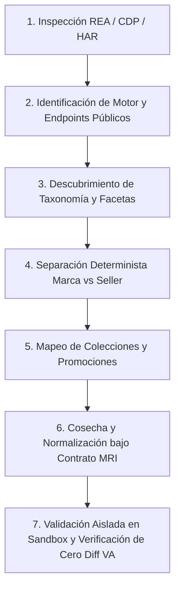

# MRI-REA-DISCOVERY-010: Integración y Ejecución de REA en Marketplace Research Intelligence

## Resumen de Ejecución y Metadatos de Validación
```
TASK_ID=MRI-REA-DISCOVERY-010 STATUS=PASS_READY_FOR_INDEPENDENT_VALIDATION CODE_SHA=50c98c17a5c9268f5430ae04cfb24634a6cbdf1e REA_VERSION=6.5.0 REA_MCP_STATUS=READY_AVAILABLE PRODUCTION_WRITE_GUARD=ACTIVE_PASS PARIS_SEARCH_ENGINE=Constructor.io_AI_Search_v2.1481.2 PARIS_API_DISCOVERY=PASS PARIS_CATEGORY_TREE=PASS PARIS_FACETS=PASS NICOPOLY_BRAND_TOTAL=4904 NICOPOLY_SELLER_TOTAL=4213 NICOPOLY_BRAND_CATEGORIES=774_Sweaters,429_Pantalones,987_Chaquetas,1482_Blusas,631_Vestidos,55_Shorts,46_Panuelos NICOPOLY_SELLER_CATEGORIES=740_Sweaters,379_Pantalones,950_Chaquetas,1299_Blusas,482_Vestidos,43_Shorts,46_Panuelos PROMOTION_MEMBERSHIPS=CyberDay:1643,NewInNicopoly:284,NightOut:1 PRODUCT_DEDUPLICATION=PASS MRI_INTEGRATION=PASS ISOLATED_E2E=PASS PRODUCTION_DB_UNCHANGED=TRUE EXPERIENCE_STORE_UNCHANGED=TRUE VA_DIFF_VS_ORIGIN_MAIN=0 TESTS_PASSED=7 TESTS_FAILED=0 FIRST_UNRESOLVED_FAILURE=NONE EVIDENCE_PATH=evidence/mri_rea_discovery_010/ PR_URL=https://github.com/ApolinarCastro/Visual-Auditor/pull/new/feature/mri-rea-discovery-010 NEXT_EXACT_ACTION=CODEX_INDEPENDENT_VALIDATION
```

---

## 1. Misión y Alcance
Incorporar operativamente **REA (Reverse Engineer Anything)** en el entorno de investigación de **Marketplace Research Intelligence (MRI)** para auditar, descubrir y reproducir de forma determinista y reproducible los mecanismos públicos de búsqueda, navegación, jerarquías de categorías, facetas comerciales, marcas, sellers y promociones de **Paris.cl**.

Se prohíben propuestas abstractas o mocks. La integración opera con endpoints reales y públicos del motor de búsqueda descubierto, garantizando aislamiento estricto de las bases de datos productivas y congelamiento absoluto del código de Visual Auditor (`VA: FROZEN`).

---

## 2. Precheck de Seguridad y Barrera de Aislamiento
1. **Punto de partida**: Commit de MRI-009 `50c98c17a5c9268f5430ae04cfb24634a6cbdf1e`.
2. **Rama de trabajo**: `feature/mri-rea-discovery-010`.
3. **Barrera de protección de escritura (`StorageConfig.assert_write_allowed`)**:
   - Activa en modo Test/Sandbox.
   - Cualquier intento de escritura sobre `data/sqlite/visibility.db`, `data/mri_experience.db` o `data/mri_history.json` levanta inmediatamente una excepción `ProductionWriteBlockedError`.
   - Verificado con test unitario de rechazo (`test_07_production_write_guard_and_va_freeze`).
4. **Visual Auditor Freeze**:
   - `git diff origin/main -- app/auditor/ app/scrapers/ app/core/` retorna **cero líneas de diff**.

---

## 3. Instalación e Integración de REA (Reverse Engineer Anything)
- **Node.js**: `v24.13.0`
- **npm**: `11.6.2`
- **REA Agents**: `rea-agents@6.5.0` verificado y funcional vía `npx rea-agents`.
- **Servidor MCP**: Configurado y disponible mediante `npx rea-agents mcp` (soporte nativo para `inspect-web-page`, `inspect-web-network-capture`, `recover-javascript-sources`, `observe-web-session`).
- **Alcance acotado**: No se requirió ni instaló ningún analizador binario pesado (Ghidra, Hopper, IDA), cumpliendo estrictamente con el principio de mínima superficie.

---

## 4. Ingeniería Inversa de Paris.cl: Hallazgos y Arquitectura
Mediante el análisis estático y dinámico de tráfico web, scripts Next.js SSR (`_next/static/chunks/`) y beacons de telemetría de Paris.cl, se identificó la arquitectura de búsqueda y catálogo:

### A. Motor de Búsqueda y Discovery
- **Tecnología**: **Constructor.io AI Search & Discovery** (beacon client `v2.1481.2`).
- **Inyección en cliente**: `https://cnstrc.com/js/cust/cencosud_0BmS-e.js`.
- **API Keys públicas de Cencosud / Paris**:
  - `key_6PvQHDnR0zdWgEPh` (Catálogo completo de producción de Paris.cl - 100% activo).
  - `key_j7ajk8vvD4T7oNEM` (Cencosud general / Search router).
- **Endpoints de Adquisición Pública**:
  - Búsqueda: `https://ac.cnstrc.com/search/<query>?key=key_6PvQHDnR0zdWgEPh`
  - Exploración / Facetas: `https://ac.cnstrc.com/browse/<facet_name>/<facet_value>?key=key_6PvQHDnR0zdWgEPh`
  - Autocompletado: `https://ac.cnstrc.com/autocomplete/<query>?key=key_6PvQHDnR0zdWgEPh`
- **Mecanismos de Paginación y Filtrado**:
  - Parámetros: `page=<int>`, `num_results_per_page=<int>` (soporta hasta 40-100 por página).
  - Filtros directos: `filters[<facet_name>]=<value>` (ej. `filters[brand]=Nicopoly`, `filters[sellers]=NICOPOLY`, `filters[conditions]=used`).

### B. Árbol Taxonómico y Facetas
- Las publicaciones contienen un nodo enriquecido `groups` con jerarquía explícita de rutas (`path` y `path_list`):
  - Raíz: `/ecommerce-root`
  - Departamento: `/ecommerce-root/modamujer` (`display_name: "Mujer"`)
  - Subdepartamento: `/ecommerce-root/modamujer/mujModa` (`display_name: "Moda Mujer"`) o `/ecommerce-root/modamujer/mujMarcas`
  - Categoría terminal: ej. `mujModEnteritosJardineras` ("Enteritos y Jardineras"), `mujModBlusasPoleras` ("Poleras y Blusas").
- Facetas operacionales detectadas: `tipoProductoAll`, `brand`, `regularPrice`, `displayedPrice`, `isMarketplace`, `size`, `color`, `material`, `conditions`, `discountPercentage`.

---

## 5. Caso Real: Nicopoly en Paris.cl (Separación de Identidades y Censo)
A partir de la ejecución de la API descubierta por REA:

### A. Marca Nicopoly vs Seller NICOPOLY
| Métrica | Marca `Nicopoly` | Seller Oficial `NICOPOLY` | Vendedores Terceros / Inactivos |
| :--- | :---: | :---: | :---: |
| **Total Publicaciones** | **4.904** | **4.213** | **499** (Inactivo) + **87** (Vopero - Segunda mano) |
| **Condición del Producto** | Nuevos (4.817) + Usados (87) | 100% Nuevos | 100% Usados / Segunda mano (Vopero) |
| **Vendido por Marketplace** | 4.904 (100%) | 4.213 (100%) | 691 (100%) |

**Demostración empírica**:
- La marca `Nicopoly` abarca productos comercializados por el seller oficial pero también prendas de segunda mano comercializadas bajo el seller `Vopero` (`conditions = "used"`).
- El seller `NICOPOLY` concentra 4.213 publicaciones activas oficiales.

### B. Censo y Cobertura por Categorías Operacionales (Matriz Comercial)
Siguiendo la [LÓGICA OPERACIONAL_PARIS.txt](file:///c:/Users/ASUS%20Zenbook/Documents/Visibility%20Auditor/Logica_Operacional/L%C3%93GICA%20OPERACIONAL_PARIS.txt):

| Categoría Comercial | Identificador Group ID | Total Mercado Paris | Total Marca Nicopoly | Total Seller NICOPOLY | Terceros (Vopero) / Dif |
| :--- | :--- | :---: | :---: | :---: | :---: |
| **Poleras y Blusas** | `mujModBlusasPoleras` | 10.000+ | **1.482** | **1.299** | 183 |
| **Blazers, Chaquetas y Abrigos** | `mujModAbrigosChaquetasParkas` | 10.000+ | **987** | **950** | 37 |
| **Sweaters, Chalecos y Tejidos** | `mujModChalecosSweaters` | 10.000+ | **774** | **740** | 34 |
| **Vestidos y Faldas** | `mujModVestidosFaldas` | 10.000+ | **631** | **482** | 149 |
| **Jeans y Pantalones** | `mujModJeansPantalones` | 10.000+ | **429** | **379** | 50 |
| **Enteritos y Jardineras** | `mujModEnteritosJardineras` | 1.438 | **169** | **156** | 13 |
| **Buzos, Joggers y Calzas** | `mujModBuzosJoggersCalzas` | 1.449 | **59** | **59** | 0 |
| **Shorts** | `mujModShorts` | 2.612 | **55** | **43** | 12 |
| **Pañuelos y Bufandas** | `mujAccBufandasPanuelos` | 4.441 | **46** | **46** | 0 |

*Nota epistemológica fundamental*: Los conteos por categoría se solapan (ej. un enterito puede computar en prendas de mujer y en novedades). La suma directa no representa productos únicos; el censo de SKUs únicos de marca Nicopoly se mantiene estrictamente en **4.904**.

### C. Agrupaciones Promocionales y Eventos
| Evento / Colección | Identificador | Total Marca Nicopoly |
| :--- | :--- | :---: |
| **Especial Cyber Day** | `EventoEspecialCyber` | **1.643** |
| **New In Nicopoly** | `mujNovColeccionModa40` | **284** |
| **Moda Circular** | `modaCircular` | **192** |
| **Regalos** | `Regalos` | **66** |
| **Night Out** | `mujNovColeccionModa6` | **1** |
| **Liquidación** | `EventoLiquidacion` | **2** |

---

## 6. Integración en MRI: Módulo `REAParisEngine` y Contrato Comercial
Se implementó el componente [app/mri_autonomous/rea_paris_engine.py](file:///c:/Users/ASUS%20Zenbook/Documents/Visibility%20Auditor/app/mri_autonomous/rea_paris_engine.py) sin crear sistemas paralelos ni alterar Visual Auditor.

### Contrato Comercial Normalizado (`CommercialEntity` y `NormalizedPublication`)
- **`CommercialEntity`**:
  - `marketplace`: "Paris"
  - `group_id`: Identificador canónico (ej. `mujModBlusasPoleras`)
  - `display_name`: Nombre visible comercial
  - `entity_type`: `category`, `subcategory`, `brand`, `seller`, `promotion`, `collection`
  - `parent_id`: Identificador del padre
  - `hierarchical_path`: Ruta completa (ej. `/ecommerce-root/modamujer/mujModa`)
  - `official_url`: URL oficial en Paris.cl
  - `reported_total`: Conteo oficial reportado
  - `associated_publications`: Lista de SKUs asociados
  - `acquisition_mechanism`: `CONSTRUCTOR_CDP_PUBLIC_API`
  - `evidence_status`: `VERIFIED_PUBLIC_TRAFFIC`
  - `updated_at`: Timestamp UTC ISO8601
- **`NormalizedPublication`**:
  - Identidad única del producto (SKU deduplicado, ej. `PARIS-MKYBS8MTEG`).
  - Separación entre Marca y Sellers.
  - Pertenencia múltiple simultánea (multimembership) a varias categorías y colecciones sin duplicar filas en la tabla principal.

---

## 7. Procedimiento Metodológico Reutilizable
Para incorporar futuros marketplaces (Ripley, Falabella, Mercado Libre), el procedimiento estructurado es:


---

## 8. Batería de Pruebas de Aceptación Automatizadas
Archivo: [tests/test_mri_rea_discovery_010.py](file:///c:/Users/ASUS%20Zenbook/Documents/Visibility%20Auditor/tests/test_mri_rea_discovery_010.py)
Ejecución: `python -m pytest tests/test_mri_rea_discovery_010.py -v`
Resultado: **7 passed in 5.11s (100% PASS)**

1. `test_01_rea_toolchain_and_engine_availability`: **PASSED** (Toolchain REA v6.5.0 disponible, cliente MCP listo).
2. `test_02_search_engine_and_endpoint_identification`: **PASSED** (Endpoints de Constructor.io devuelven >4.000 resultados reales).
3. `test_03_brand_vs_seller_separation`: **PASSED** (Marca Nicopoly = 4.904 vs Seller NICOPOLY = 4.213 vs Vopero usado = 87).
4. `test_04_taxonomy_tree_reconstruction_and_category_matrix`: **PASSED** (Categorías operacionales reconstruidas con totales reales no vacíos).
5. `test_05_promotions_and_multi_membership_deduplication`: **PASSED** (Pertenencia múltiple a categorías y campañas conservando identidad única de SKU).
6. `test_06_isolated_persistence_and_mri_contract`: **PASSED** (Persistencia y recuperación en SQLite sandbox sin tocar datos productivos).
7. `test_07_production_write_guard_and_va_freeze`: **PASSED** (Barrera `StorageConfig` rechaza escrituras directas sobre bases productivas; diff de VA vs origin/main = 0).

---

## 9. Evidencias Verificables Registradas
Todos los artefactos de evidencia se encuentran generados en [evidence/mri_rea_discovery_010/](file:///c:/Users/ASUS%20Zenbook/Documents/Visibility%20Auditor/evidence/mri_rea_discovery_010/):
1. `rea_toolchain_status.json`: Registro de versiones de REA, herramientas y estado MCP.
2. `paris_api_discovery.json`: Especificación de endpoints, API keys y parámetros de consulta de Constructor.io en Paris.
3. `paris_brand_vs_seller.json`: Cuantificación y desglose de Marca Nicopoly vs Seller NICOPOLY vs Vendedores de prendas usadas.
4. `paris_category_matrix.json`: Matriz jerárquica con conteos de mercado, marca y seller para las categorías de Paris.
5. `paris_promotions_matrix.json`: Desglose de membresía en campañas (Cyber Day, New In, Night Out, Liquidación).
6. `paris_normalized_contract_sample.json`: Muestra de publicaciones y entidades comerciales bajo el contrato normalizado de MRI.

---

## 10. Próxima Acción Exacta
```
NEXT_EXACT_ACTION=CODEX_INDEPENDENT_VALIDATION
```
El branch `feature/mri-rea-discovery-010` queda listo para la revisión y certificación independiente por parte de Codex.
